# Poly Haven: Streets & Town HDRIs

**51 assets from [Poly Haven](https://polyhaven.com), dedicated to the public domain under [CC0](https://polyhaven.com/license).** Use them in any game, free or paid, and change them however you like; no credit is needed.

HDRI skies and environments as 1K and 2K Radiance `.hdr` images, for lighting and backgrounds. 411.5 MB in all.

This is a copy kept by [zuujis-cc0](https://github.com/zuujis-cc0) so game makers can take single files from GitHub. It is not made by or affiliated with Poly Haven: the originals, often in more formats and higher resolutions, are on [polyhaven.com](https://polyhaven.com). If they help you, consider [supporting Poly Haven](https://www.patreon.com/polyhaven/overview).

Every file is listed in [MANIFEST.tsv](MANIFEST.tsv) with its size and SHA-256. More free assets: [the Zuujis collection](https://github.com/zuujis-cc0/free-game-assets#readme).

| | | | |
| :-: | :-: | :-: | :-: |
| <a href="stadium_exterior">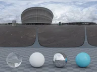</a> <b><a href="stadium_exterior">Stadium Exterior</a></b> by Grzegorz Wronkowski · <a href="https://polyhaven.com/a/stadium_exterior">source</a> | <a href="stone_alley">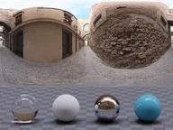</a> <b><a href="stone_alley">Stone Alley</a></b> by Andreas Mischok · <a href="https://polyhaven.com/a/stone_alley">source</a> | <a href="stone_alley_02">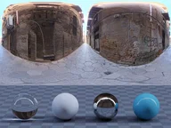</a> <b><a href="stone_alley_02">Stone Alley 02</a></b> by Andreas Mischok · <a href="https://polyhaven.com/a/stone_alley_02">source</a> | <a href="stone_alley_03">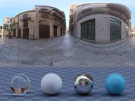</a> <b><a href="stone_alley_03">Stone Alley 03</a></b> by Andreas Mischok · <a href="https://polyhaven.com/a/stone_alley_03">source</a> |
| <a href="street_lamp">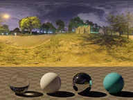</a> <b><a href="street_lamp">Street Lamp</a></b> by Greg Zaal · <a href="https://polyhaven.com/a/street_lamp">source</a> | <a href="stuttgart_suburbs">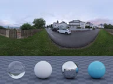</a> <b><a href="stuttgart_suburbs">Stuttgart Suburbs</a></b> by Andreas Mischok · <a href="https://polyhaven.com/a/stuttgart_suburbs">source</a> | <a href="suburban_parking_area">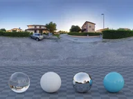</a> <b><a href="suburban_parking_area">Suburban Parking Area</a></b> by Jacopo Voltolina · <a href="https://polyhaven.com/a/suburban_parking_area">source</a> | <a href="sunset_jhbcentral">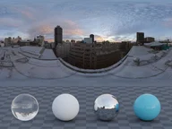</a> <b><a href="sunset_jhbcentral">Joburg Central Sunset</a></b> by Dimitrios Savva, Greg Zaal · <a href="https://polyhaven.com/a/sunset_jhbcentral">source</a> |
| <a href="tears_of_steel_bridge">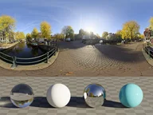</a> <b><a href="tears_of_steel_bridge">Tears of Steel Bridge</a></b> by Greg Zaal · <a href="https://polyhaven.com/a/tears_of_steel_bridge">source</a> | <a href="teatro_massimo">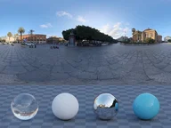</a> <b><a href="teatro_massimo">Teatro Massimo</a></b> by Andreas Mischok · <a href="https://polyhaven.com/a/teatro_massimo">source</a> | <a href="teutonic_castle_moat">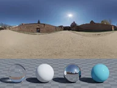</a> <b><a href="teutonic_castle_moat">Teutonic Castle Moat</a></b> by Grzegorz Wronkowski · <a href="https://polyhaven.com/a/teutonic_castle_moat">source</a> | <a href="tiber_1">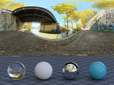</a> <b><a href="tiber_1">Tiber 1</a></b> by Greg Zaal, Rico Cilliers · <a href="https://polyhaven.com/a/tiber_1">source</a> |
| <a href="twilight_sunset">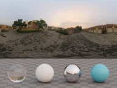</a> <b><a href="twilight_sunset">Twilight Sunset</a></b> by Dimitrios Savva, Jarod Guest · <a href="https://polyhaven.com/a/twilight_sunset">source</a> | <a href="ulmer_muenster">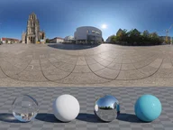</a> <b><a href="ulmer_muenster">Ulmer Muenster</a></b> by Andreas Mischok · <a href="https://polyhaven.com/a/ulmer_muenster">source</a> | <a href="under_bridge">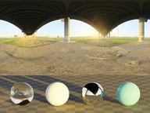</a> <b><a href="under_bridge">Under Bridge</a></b> by Greg Zaal · <a href="https://polyhaven.com/a/under_bridge">source</a> | <a href="urban_alley_01">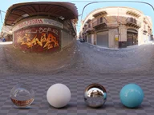</a> <b><a href="urban_alley_01">Urban Alley 01</a></b> by Andreas Mischok · <a href="https://polyhaven.com/a/urban_alley_01">source</a> |
| <a href="urban_courtyard">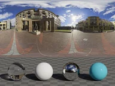</a> <b><a href="urban_courtyard">Urban Courtyard</a></b> by Greg Zaal, Rico Cilliers · <a href="https://polyhaven.com/a/urban_courtyard">source</a> | <a href="urban_courtyard_02">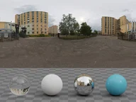</a> <b><a href="urban_courtyard_02">Urban Courtyard 02</a></b> by Sergej Majboroda · <a href="https://polyhaven.com/a/urban_courtyard_02">source</a> | <a href="urban_street_01">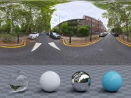</a> <b><a href="urban_street_01">Urban Street 01</a></b> by Andreas Mischok · <a href="https://polyhaven.com/a/urban_street_01">source</a> | <a href="urban_street_02">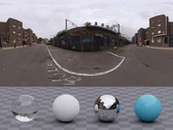</a> <b><a href="urban_street_02">Urban Street 02</a></b> by Andreas Mischok · <a href="https://polyhaven.com/a/urban_street_02">source</a> |
| <a href="urban_street_03">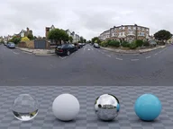</a> <b><a href="urban_street_03">Urban Street 03</a></b> by Andreas Mischok · <a href="https://polyhaven.com/a/urban_street_03">source</a> | <a href="urban_street_04">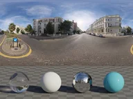</a> <b><a href="urban_street_04">Urban Street 04</a></b> by Andreas Mischok · <a href="https://polyhaven.com/a/urban_street_04">source</a> | <a href="ushaka_dolphin_stadium">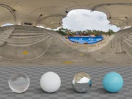</a> <b><a href="ushaka_dolphin_stadium">Ushaka Dolphin Stadium</a></b> by Dario Barresi · <a href="https://polyhaven.com/a/ushaka_dolphin_stadium">source</a> | <a href="vatican_road">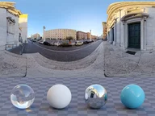</a> <b><a href="vatican_road">Vatican Road</a></b> by Greg Zaal, Rico Cilliers · <a href="https://polyhaven.com/a/vatican_road">source</a> |
| <a href="venetian_crossroads">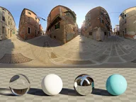</a> <b><a href="venetian_crossroads">Venetian Crossroads</a></b> by Greg Zaal, Rico Cilliers · <a href="https://polyhaven.com/a/venetian_crossroads">source</a> | <a href="venice_dawn_1">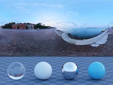</a> <b><a href="venice_dawn_1">Venice Dawn 1</a></b> by Greg Zaal, Rico Cilliers · <a href="https://polyhaven.com/a/venice_dawn_1">source</a> | <a href="venice_dawn_2">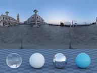</a> <b><a href="venice_dawn_2">Venice Dawn 2</a></b> by Greg Zaal, Rico Cilliers · <a href="https://polyhaven.com/a/venice_dawn_2">source</a> | <a href="venice_sunrise">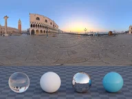</a> <b><a href="venice_sunrise">Venice Sunrise</a></b> by Greg Zaal, Rico Cilliers · <a href="https://polyhaven.com/a/venice_sunrise">source</a> |
| <a href="victoria_curve_01">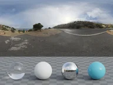</a> <b><a href="victoria_curve_01">Victoria Curve 01</a></b> by Greg Zaal · <a href="https://polyhaven.com/a/victoria_curve_01">source</a> | <a href="victoria_curve_02">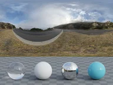</a> <b><a href="victoria_curve_02">Victoria Curve 02</a></b> by Greg Zaal · <a href="https://polyhaven.com/a/victoria_curve_02">source</a> | <a href="victoria_sunset">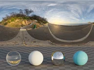</a> <b><a href="victoria_sunset">Victoria Sunset</a></b> by Greg Zaal · <a href="https://polyhaven.com/a/victoria_sunset">source</a> | <a href="vignaioli">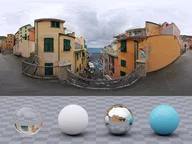</a> <b><a href="vignaioli">Vignaioli</a></b> by Greg Zaal, Rico Cilliers · <a href="https://polyhaven.com/a/vignaioli">source</a> |
| <a href="vignaioli_night">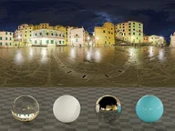</a> <b><a href="vignaioli_night">Vignaioli Night</a></b> by Greg Zaal, Rico Cilliers · <a href="https://polyhaven.com/a/vignaioli_night">source</a> | <a href="wide_street_01">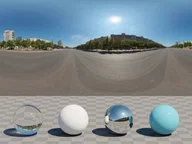</a> <b><a href="wide_street_01">Wide Street 01</a></b> by Sergej Majboroda · <a href="https://polyhaven.com/a/wide_street_01">source</a> | <a href="wide_street_02">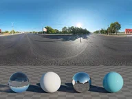</a> <b><a href="wide_street_02">Wide Street 02</a></b> by Sergej Majboroda · <a href="https://polyhaven.com/a/wide_street_02">source</a> | <a href="winter_evening">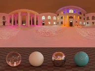</a> <b><a href="winter_evening">Winter Evening</a></b> by Sergej Majboroda · <a href="https://polyhaven.com/a/winter_evening">source</a> |
| <a href="wobbly_bridge">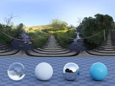</a> <b><a href="wobbly_bridge">Wobbly Bridge</a></b> by Greg Zaal · <a href="https://polyhaven.com/a/wobbly_bridge">source</a> | <a href="wooden_motel">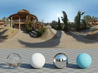</a> <b><a href="wooden_motel">Wooden Motel</a></b> by Sergej Majboroda · <a href="https://polyhaven.com/a/wooden_motel">source</a> | <a href="zawiszy_czarnego">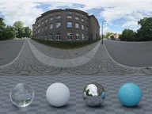</a> <b><a href="zawiszy_czarnego">Zawiszy Czarnego</a></b> by Grzegorz Wronkowski · <a href="https://polyhaven.com/a/zawiszy_czarnego">source</a> | <a href="zhengyang_gate">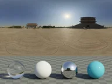</a> <b><a href="zhengyang_gate">Zhengyang Gate</a></b> by Greg Zaal · <a href="https://polyhaven.com/a/zhengyang_gate">source</a> |
| <a href="zwartkops_curve_afternoon">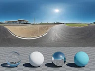</a> <b><a href="zwartkops_curve_afternoon">Zwartkops Curve Afternoon</a></b> by Dimitrios Savva, Jarod Guest · <a href="https://polyhaven.com/a/zwartkops_curve_afternoon">source</a> | <a href="zwartkops_curve_morning">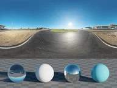</a> <b><a href="zwartkops_curve_morning">Zwartkops Curve Morning</a></b> by Dimitrios Savva, Jarod Guest · <a href="https://polyhaven.com/a/zwartkops_curve_morning">source</a> | <a href="zwartkops_curve_sunset">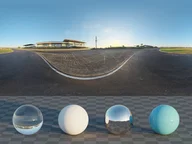</a> <b><a href="zwartkops_curve_sunset">Zwartkops Curve Sunset</a></b> by Dimitrios Savva, Jarod Guest · <a href="https://polyhaven.com/a/zwartkops_curve_sunset">source</a> | <a href="zwartkops_pit">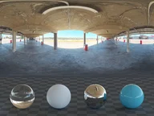</a> <b><a href="zwartkops_pit">Zwartkops Pit</a></b> by Dimitrios Savva, Jarod Guest · <a href="https://polyhaven.com/a/zwartkops_pit">source</a> |
| <a href="zwartkops_start_afternoon">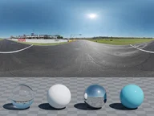</a> <b><a href="zwartkops_start_afternoon">Zwartkops Start Afternoon</a></b> by Dimitrios Savva, Jarod Guest · <a href="https://polyhaven.com/a/zwartkops_start_afternoon">source</a> | <a href="zwartkops_start_morning">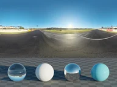</a> <b><a href="zwartkops_start_morning">Zwartkops Start Morning</a></b> by Dimitrios Savva, Jarod Guest · <a href="https://polyhaven.com/a/zwartkops_start_morning">source</a> | <a href="zwartkops_start_sunset">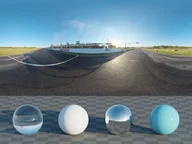</a> <b><a href="zwartkops_start_sunset">Zwartkops Start Sunset</a></b> by Dimitrios Savva, Jarod Guest · <a href="https://polyhaven.com/a/zwartkops_start_sunset">source</a> | <a href="zwartkops_straight_afternoon">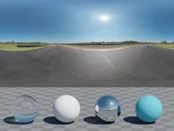</a> <b><a href="zwartkops_straight_afternoon">Zwartkops Straight Afternoon</a></b> by Dimitrios Savva, Jarod Guest · <a href="https://polyhaven.com/a/zwartkops_straight_afternoon">source</a> |
| <a href="zwartkops_straight_morning">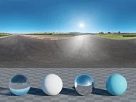</a> <b><a href="zwartkops_straight_morning">Zwartkops Straight Morning</a></b> by Dimitrios Savva, Jarod Guest · <a href="https://polyhaven.com/a/zwartkops_straight_morning">source</a> | <a href="zwartkops_straight_sunset">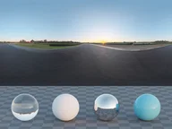</a> <b><a href="zwartkops_straight_sunset">Zwartkops Straight Sunset</a></b> by Dimitrios Savva, Jarod Guest · <a href="https://polyhaven.com/a/zwartkops_straight_sunset">source</a> |  <b><a href="zwinger_night">Zwinger Night</a></b> by Greg Zaal · <a href="https://polyhaven.com/a/zwinger_night">source</a> |  |

---

Kept up to date by this repository's own [update workflow](.github/workflows/update.yml), with code and plan from [cc0-mirror](https://github.com/zuujis-cc0/cc0-mirror). Something wrong? [Open an issue there](https://github.com/zuujis-cc0/cc0-mirror/issues/new) or use the [private report form](https://games.zuujis.com/report).
